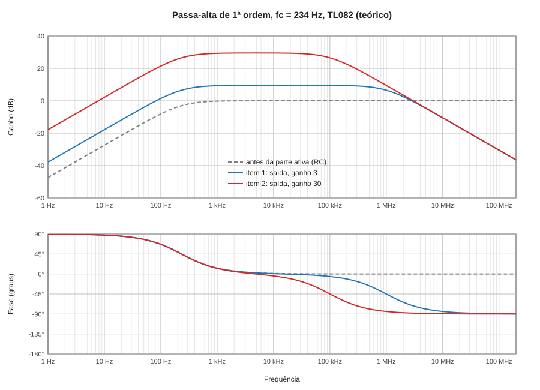
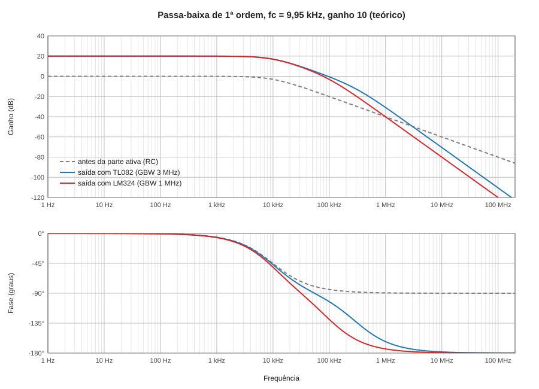
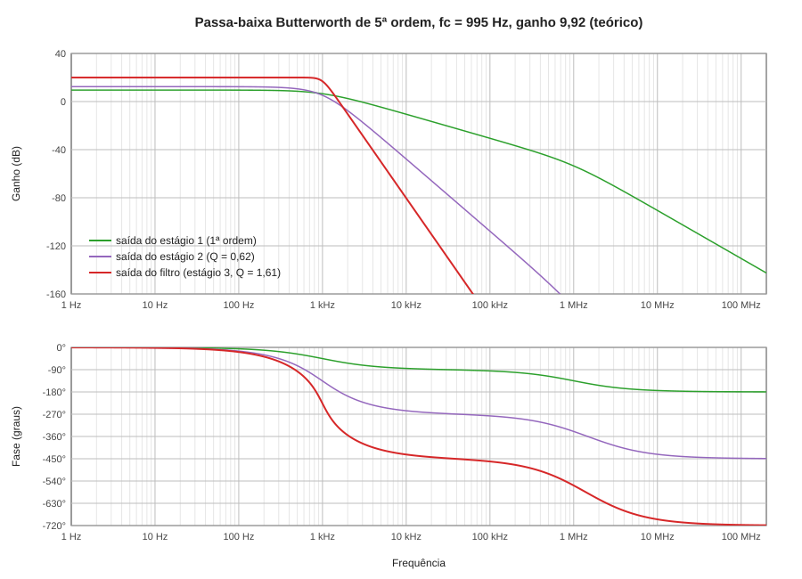
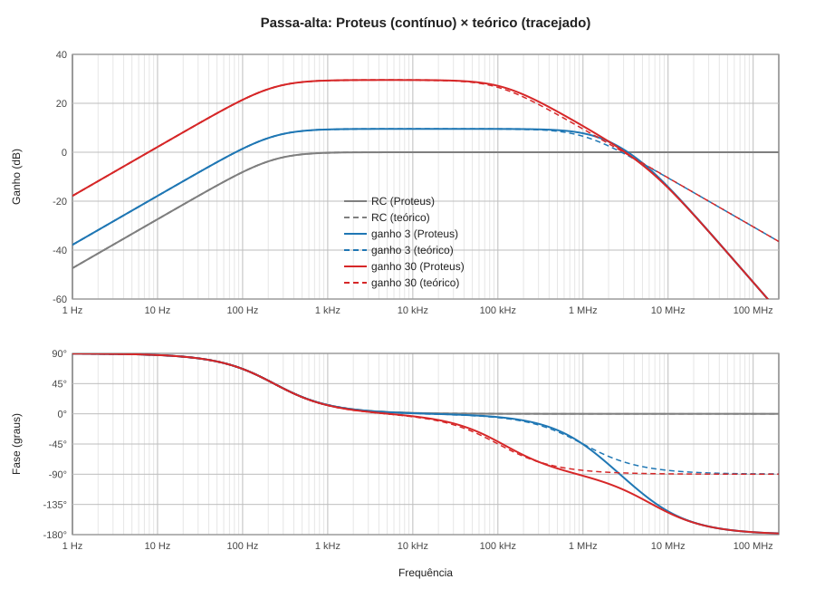
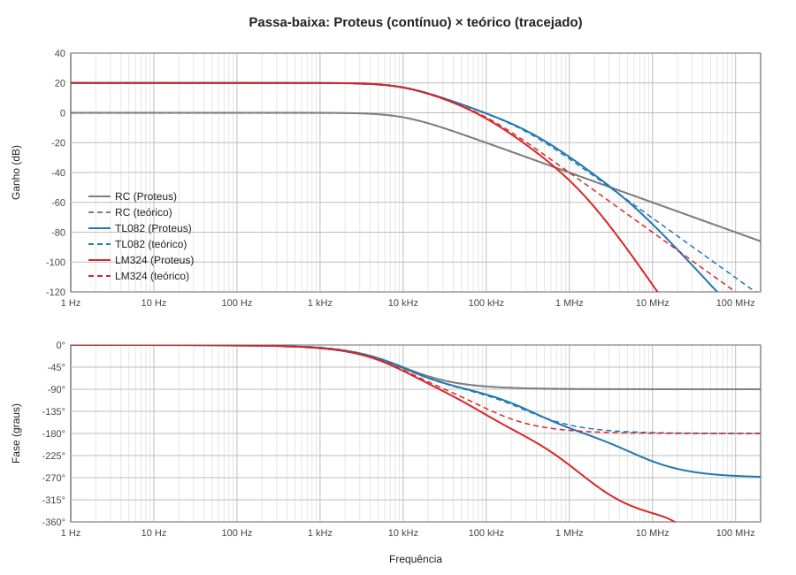
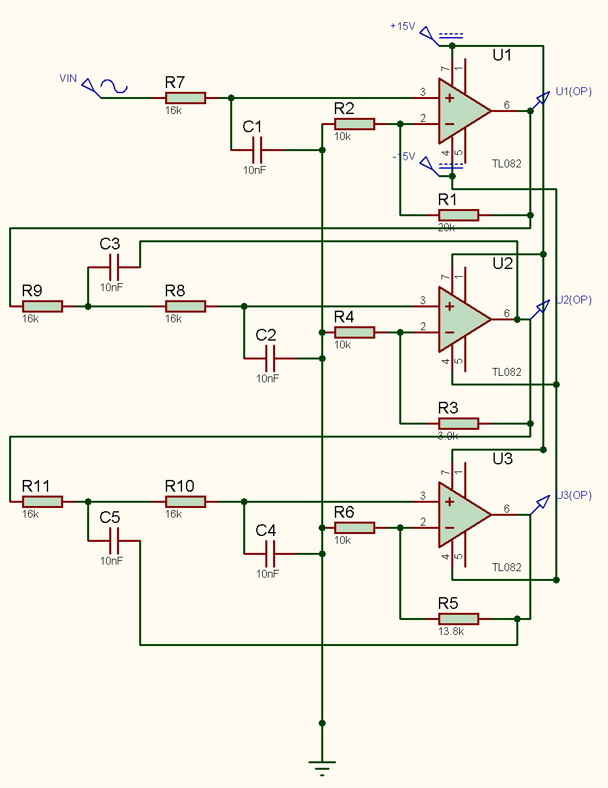
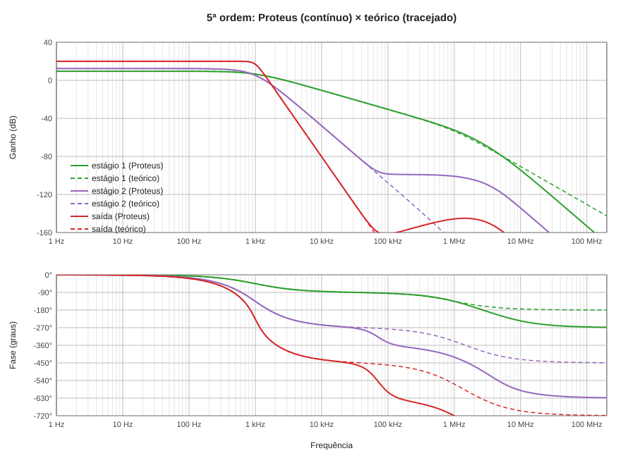

# Análise 01 - Filtros ativos com amplificadores operacionais

**Curso:** Engenharia Eletrônica **Unidade curricular:** Eletrônica III **Professor:** Luis Carlos Martinhago Schlichting

## 1. Objetivo

Dimensionar e analisar cinco filtros ativos: dois passa-alta de primeira ordem com corte em 230 Hz e ganhos 3 e 30 (TL082), um passa-baixa de primeira ordem com corte em 10 kHz e ganho 10 (TL082 e LM324) e um passa-baixa de quinta ordem, que também é montado em bancada. Para cada filtro: projeto, previsão teórica, simulação no Proteus de 1 Hz a 200 MHz e leitura de ganho na banda passante, ganho e fase no corte e taxa de atenuação.

## 2. Projeto

### 2.1 Topologia dos filtros de primeira ordem

Os três filtros de primeira ordem usam uma rede RC passiva seguida de um amplificador não inversor. A rede define o corte, o amplificador define o ganho e isola a rede da carga. Essa separação dá os dois pontos de medida pedidos: o nó entre R e C (antes da parte ativa) e a saída do amplificador (depois).

$$f_c=\frac{1}{2\pi RC}\qquad K=1+\frac{R_f}{R_g}$$

Passa-alta (C em série, R para o terra) e passa-baixa (R em série, C para o terra):

$$H_{PA}(s)=K\,\frac{sRC}{1+sRC}\qquad H_{PB}(s)=K\,\frac{1}{1+sRC}$$

### 2.2 Itens 1 e 2: passa-alta, 230 Hz

Com C = 100 nF, o resistor calculado é

$$R=\frac{1}{2\pi\cdot 230\cdot 100\ \text{nF}}=6{,}92\ \text{k}\Omega$$

O valor comercial mais próximo é 6,8 kΩ, que leva o corte para 234 Hz, 1,8 % acima do pedido e dentro da tolerância dos componentes. Para o ganho, $R_f/R_g=K-1$:

| Item | Ganho | $R_f/R_g$ | $R_f$ | $R_g$ |
|:---:|---:|---:|---|---:|
| 1 | 3 | 2 | 20 kΩ | 10 kΩ |
| 2 | 30 | 29 | 29 kΩ (27 kΩ + 2 kΩ) | 1 kΩ |

O enunciado pede ganho 30 no item 2 e fala em "ganhos 3 e 29" no tópico de comparação. Adotei 30; 29 é a razão $R_f/R_g$ que produz esse ganho.

### 2.3 Item 3: passa-baixa, 10 kHz, ganho 10

Com C = 10 nF, R = 1,59 kΩ. Com 1,6 kΩ o corte fica em 9,95 kHz, 0,5 % abaixo do pedido. Ganho 10 pede $R_f/R_g=9$: $R_g$ = 1 kΩ e $R_f$ = 9 kΩ, obtido com dois resistores de 18 kΩ em paralelo. O mesmo circuito é simulado duas vezes, com TL082 e com LM324.

### 2.4 Item 4: passa-baixa de quinta ordem

Escolhas: aproximação de Butterworth, corte em 1 kHz, ganho total 10 (20 dB) e TL082.

Butterworth, e não Chebyshev, porque a resposta é plana na banda passante e os estágios pedem fator de qualidade baixo. O maior Q de um Butterworth de quinta ordem é 1,62; um Chebyshev de 1 dB da mesma ordem pede 5,6 no último estágio, valor difícil de acertar em protoboard com resistores de 5 %. O corte em 1 kHz fica longe dos limites de banda e de slew rate do TL082, que distorceram as medidas da Atividade 02.

O polinômio de Butterworth de quinta ordem, normalizado, se divide em um termo de primeira ordem e dois de segunda:

$$D(s)=(s+1)(s^2+1{,}618\,s+1)(s^2+0{,}618\,s+1)$$

O filtro é a cascata de três estágios: um de primeira ordem, como o do item 3, e dois Sallen-Key. Usei o Sallen-Key de componentes iguais (os dois resistores iguais a R, os dois capacitores iguais a C), em que o ganho do estágio define o amortecimento:

$$H(s)=\frac{K}{(sRC)^2+(3-K)\,sRC+1}\qquad \frac{1}{Q}=3-K$$

Todos os estágios têm o mesmo RC, o que deixa só dois valores no caminho do sinal. Com C = 10 nF, R = 15,9 kΩ; com 16 kΩ o corte fica em 995 Hz.

| Estágio | Termo | $1/Q$ pedido | K pedido | $R_b$ e $R_a$ | K obtido | $1/Q$ obtido |
|:---:|---|---:|---:|---|---:|---:|
| 1 | $s+1$ | n/a | livre | 20 kΩ e 10 kΩ | 3,00 | n/a |
| 2 | $s^2+1{,}618s+1$ | 1,618 | 1,382 | 3,9 kΩ e 10 kΩ | 1,39 | 1,61 |
| 3 | $s^2+0{,}618s+1$ | 0,618 | 2,382 | 13,8 kΩ (12 kΩ + 1,8 kΩ) e 10 kΩ | 2,38 | 0,62 |

Os ganhos dos estágios 2 e 3 são impostos pelo Q e somam 3,31 V/V. O estágio 1 completa o ganho total: com K = 3, o filtro fica com 3 × 1,39 × 2,38 = 9,92 V/V (19,9 dB). O estágio de maior Q vai por último, para o pico de resposta dele não saturar os anteriores.

O filtro usa três amplificadores, ou seja, dois TL082. O quarto amplificador fica como seguidor com a entrada no terra.

## 3. Previsão teórica

As curvas usam o amplificador com um polo dominante, $A(f)=A_0/(1+jf/f_p)$, com produto ganho-banda de 3 MHz para o TL082 e 1 MHz para o LM324. Em cada estágio não inversor isso acrescenta um polo em $GBW/K$, como medido na Atividade 02. Gráficos e tabelas saem de `scripts/gerar_graficos.ps1`.

### 3.1 Passa-alta (itens 1 e 2)

*Gráfico 1 - Passa-alta teórico: RC sozinho, saída com ganho 3 e saída com ganho 30.*

| Curva | Ganho na banda passante | Corte inferior | Ganho no corte | Fase no corte | Taxa de atenuação | Corte superior |
|---|---:|---:|---:|---:|---:|---:|
| RC (antes) | 0 dB | 234 Hz | -3,0 dB | +45° | 20 dB/déc | não há |
| Item 1, ganho 3 | 9,54 dB | 234 Hz | 6,53 dB | +45° | 20 dB/déc | 1 MHz |
| Item 2, ganho 30 | 29,5 dB | 233 Hz | 26,5 dB | +45° | 20 dB/déc | 100 kHz |

A parte ativa desloca a curva de ganho para cima, 9,5 dB no item 1 e 29,5 dB no item 2, sem mexer no corte de 234 Hz nem na fase em baixa frequência. O que ela acrescenta é um limite superior: o amplificador deixa de sustentar o ganho em $GBW/K$, e o passa-alta vira, na prática, um passa-faixa. Com ganho 3 a faixa vai até 1 MHz; com ganho 30, até 100 kHz. O RC sozinho não tem esse limite.

### 3.2 Passa-baixa (item 3)

*Gráfico 2 - Passa-baixa teórico: RC sozinho, saída com TL082 e saída com LM324.*

| Curva | Ganho na banda passante | Corte | Ganho no corte | Fase no corte | Taxa logo após o corte | Taxa de 100 kHz a 1 MHz |
|---|---:|---:|---:|---:|---:|---:|
| RC (antes) | 0 dB | 9,95 kHz | -3,0 dB | -45,0° | -20 dB/déc | -20 dB/déc |
| TL082 | 20,0 dB | 9,94 kHz | 17,0 dB | -46,9° | -20 dB/déc | -30 dB/déc |
| LM324 | 20,0 dB | 9,85 kHz | 17,0 dB | -50,3° | -20 dB/déc | -37 dB/déc |

Com ganho 10, o polo do amplificador cai em 300 kHz no TL082 e em 100 kHz no LM324. No LM324 ele está só uma década acima do corte: já atrasa a fase em 5° em 10 kHz, puxa o corte de 9,95 para 9,85 kHz e faz a atenuação passar de 20 para 40 dB/déc a partir de 100 kHz. No TL082 os mesmos efeitos aparecem três vezes mais acima.

### 3.3 Quinta ordem (item 4)

*Gráfico 3 - Quinta ordem teórico: saída de cada estágio.*

| Ponto | Ganho na banda passante | Corte (-3 dB) | Ganho no corte | Fase no corte | Taxa de atenuação |
|---|---:|---:|---:|---:|---:|
| Saída do estágio 1 | 9,54 dB | 995 Hz | 6,53 dB | -45° | -20 dB/déc |
| Saída do estágio 2 | 12,4 dB | 640 Hz | 9,39 dB | -93° | -60 dB/déc |
| Saída do filtro | 19,9 dB | 995 Hz | 16,9 dB | -225° | -100 dB/déc |

Cada polo contribui com 20 dB/déc e 45° no corte: cinco polos dão 100 dB/déc e -225°. Os estágios isolados não são Butterworth. O estágio 2 cai cedo, com -3 dB já em 640 Hz, e o estágio 3 tem um pico perto do corte que compensa essa queda; só o produto dos três é plano até 1 kHz.

## 4. Simulação no Proteus

Desenhei três projetos, na pasta `proteus/`: `itens_1_2_passa_alta.pdsprj`, `item_3_passa_baixa.pdsprj` e `item_4_quinta_ordem.pdsprj`. Em todos, a entrada é um gerador senoidal `VIN` de 1 V, a alimentação é de ±15 V e o gráfico FREQUENCY varre de 1 Hz a 200 MHz, com 100 pontos por década, ganho em dB no eixo esquerdo e fase no direito. Há uma ponta de tensão no nó RC e uma em cada saída.

As leituras saem dos dados exportados do gráfico (Graph > Export Graph Data), guardados em `dados/` e processados por `scripts/gerar_graficos.ps1`:

- **Ganho na banda passante:** valor do patamar (máximo, no passa-alta; valor em 1 Hz, no passa-baixa).
- **Frequência de corte:** onde o ganho cruza o patamar menos 3 dB, com interpolação entre os pontos vizinhos.
- **Ganho e fase no corte:** valores das duas curvas nessa frequência.
- **Taxa de atenuação:** diferença de ganho entre duas frequências, dividida pelo número de décadas entre elas, na região de queda.

Os amplificadores usam os modelos SPICE do próprio Proteus: `TL082`, da biblioteca da Texas, e `LM324/NS`, da National. Os modelos TL081 e TL082 dessa biblioteca dão curvas idênticas.

### 4.1 Passa-alta (itens 1 e 2)

*Figura 1 - Passa-alta no Proteus: U1 com ganho 3 e U2 com ganho 30, os dois ligados ao mesmo nó RC.*

*Gráfico 4 - Passa-alta: Proteus em linha contínua, teórico em tracejado.*

| Curva | Ganho na banda passante | Corte inferior | Ganho no corte | Fase no corte | Taxa de atenuação | Corte superior |
|---|---:|---:|---:|---:|---:|---:|
| RC (antes) | 0,00 dB | 234 Hz | -3,01 dB | +45,0° | 20,0 dB/déc | não há |
| Item 1, ganho 3 | 9,54 dB | 234 Hz | 6,53 dB | +45,0° | 20,0 dB/déc | 1,38 MHz |
| Item 2, ganho 30 | 29,52 dB | 233 Hz | 26,51 dB | +45,0° | 20,0 dB/déc | 117 kHz |

**Antes e depois da parte ativa.** Abaixo de 10 kHz as três curvas têm a mesma forma: a saída é a curva do RC somada a 9,54 dB ou a 29,52 dB, com a mesma fase. Em 234 Hz as três estão 3 dB abaixo do próprio patamar e em +45°. A parte ativa não altera o corte nem a inclinação de 20 dB/déc.

**Influência do ganho.** O ganho só muda o comportamento em alta frequência. Em 100 kHz, a saída de ganho 3 ainda está em 9,52 dB e -4,9°; a de ganho 30 já caiu para 27,1 dB e -41°. O corte superior ficou em 1,38 MHz e 117 kHz, uma razão de 11,8 para ganhos na razão de 10: o produto ganho-banda se conserva, e multiplicar o ganho por 10 custa uma década de banda.

**Influência do amplificador.** O modelo do Proteus tem produto ganho-banda entre 3,5 e 4,1 MHz (117 kHz × 30 e 1,38 MHz × 3), acima dos 3 MHz que usei na previsão; por isso os cortes superiores simulados são 16 % e 38 % maiores que os teóricos. Acima de 3 MHz a simulação cai mais rápido e a fase passa de -90°, chegando a -178° em 200 MHz. São polos adicionais do modelo, que o amplificador de um polo da seção 3 não tem.

### 4.2 Passa-baixa (item 3)

*Figura 2 - Passa-baixa no Proteus: U1 com modelo TL082 e U2 com modelo LM324, mesmos resistores de ganho.*

*Gráfico 5 - Passa-baixa: Proteus em linha contínua, teórico em tracejado.*

| Curva | Ganho na banda passante | Corte | Ganho no corte | Fase no corte | Taxa de 20 a 40 kHz | Taxa de 100 kHz a 1 MHz |
|---|---:|---:|---:|---:|---:|---:|
| RC (antes) | 0,00 dB | 9,94 kHz | -3,01 dB | -45,0° | -17,7 dB/déc | -20,0 dB/déc |
| TL082 | 20,00 dB | 9,93 kHz | 16,99 dB | -46,6° | -17,8 dB/déc | -29,1 dB/déc |
| LM324 | 20,00 dB | 9,81 kHz | 16,99 dB | -52,0° | -19,8 dB/déc | -41,3 dB/déc |

Entre 20 e 40 kHz a curva ainda está no joelho, e nem o RC ideal chegou aos 20 dB/déc.

**Antes e depois da parte ativa.** Até o corte, a saída é o RC deslocado de 20 dB. Depois dele as curvas se separam do RC: a fase do RC para em -90° e a atenuação fica em 20 dB/déc, enquanto as saídas continuam atrasando e caem mais rápido, porque o polo do amplificador se soma ao do filtro. Acima de 3 MHz a saída do TL082 fica abaixo do próprio sinal no nó RC: o amplificador, que dava ganho 10, passa a atenuar.

**TL082 e LM324.** Na banda passante e no corte os dois são equivalentes em módulo: 20,00 dB e 9,93 kHz contra 9,81 kHz. A diferença aparece na fase e acima do corte:

| Frequência | TL082 | LM324 |
|---:|---:|---:|
| 10 kHz | 16,96 dB, -46,9° | 16,90 dB, -52,7° |
| 100 kHz | -0,4 dB, -101° | -3,9 dB, -142° |
| 1 MHz | -29,6 dB, -169° | -45,3 dB, -244° |

Com ganho 10, o polo de malha fechada do LM324 fica perto de 100 kHz, uma década acima do corte, e o do TL082 perto de 400 kHz. No corte o LM324 já atrasa 5,4° a mais que o TL082 e 7° a mais que o RC. Em 1 MHz a diferença entre os dois é de 16 dB e 75°. O LM324 simulado também mostra polos extras mais cedo que a previsão de um polo: a fase teórica parava em -180°, e a simulada passa de -360° em 20 MHz. Para um filtro de 10 kHz com ganho 10, o TL082 preserva melhor a resposta de primeira ordem; o LM324 serve se só o módulo até o corte importar.

### 4.3 Quinta ordem (item 4)

*Figura 3 - Quinta ordem no Proteus: estágio de primeira ordem (U1) e dois Sallen-Key (U2 e U3).*

*Gráfico 6 - Quinta ordem: Proteus em linha contínua, teórico em tracejado.*

| Ponto | Ganho na banda passante | Corte (-3 dB) | Ganho no corte | Fase no corte | Taxa de atenuação |
|---|---:|---:|---:|---:|---:|
| Saída do estágio 1 | 9,54 dB | 995 Hz | 6,53 dB | -45,0° | -20,0 dB/déc (10 a 100 kHz) |
| Saída do estágio 2 | 12,40 dB | 639 Hz | 9,39 dB | -93,2° | -57,5 dB/déc (2 a 10 kHz) |
| Saída do filtro | 19,93 dB | 995 Hz | 16,92 dB | -225,4° | -100,0 dB/déc (2 a 4 kHz) |

O filtro simulado repete a previsão: ganho de 19,93 dB, corte em 995 Hz, -225° no corte e 100 dB/déc. A banda passante é plana, com máximo de 19,95 dB em 500 Hz, 0,02 dB acima do patamar. De 2 kHz a 10 kHz a saída vai de -10,3 dB a -80,3 dB, 100 dB por década.

**Influência do amplificador.** Em 1 kHz o TL082 tem ganho de malha aberta de sobra e não aparece na resposta. Ele aparece na banda de rejeição: a partir de 100 kHz a saída do estágio 2 para de cair e forma um patamar em -99 dB, e a saída do filtro, depois de chegar a -162 dB em 100 kHz, sobe até -146 dB em 1 MHz. No Sallen-Key o capacitor de realimentação liga a entrada direto à saída do amplificador; quando o ganho de malha cai, a impedância de saída sobe e o sinal vaza por esse caminho. O modelo ideal da seção 3 não prevê isso. Na bancada o efeito fica abaixo do ruído do osciloscópio: -99 dB de 1 Vpp são 11 µV.

Leituras do Proteus nas frequências que vou medir na bancada:

| Frequência | Ganho simulado | Fase simulada | Ganho teórico | Fase teórica |
|---:|---:|---:|---:|---:|
| 100 Hz | 19,93 dB | -19° | 19,9 dB | -19° |
| 200 Hz | 19,94 dB | -37° | 19,9 dB | -37° |
| 500 Hz | 19,95 dB | -97° | 20,0 dB | -97° |
| 800 Hz | 19,53 dB | -167° | 19,5 dB | -168° |
| 1 kHz | 16,82 dB | -227° | 16,8 dB | -227° |
| 1,2 kHz | 11,10 dB | -276° | 11,2 dB | -275° |
| 1,5 kHz | 1,64 dB | -320° | 2,0 dB | -318° |
| 2 kHz | -10,30 dB | -355° | -10,4 dB | -355° |
| 3 kHz | -28,31 dB | -389° | -28,0 dB | -388° |

As linhas de 1,2, 1,5 e 3 kHz diferem em até 0,4 dB porque os pontos exportados mais próximos estão em 1,202, 1,514 e 3,02 kHz, e nessa região a curva cai cerca de 0,4 dB a cada 1 % de frequência.

## 5. Implementação prática do filtro de quinta ordem

> **Pendente.** Montagem e medidas ainda não feitas. O roteiro está em `guia_bancada.md`.

Previsão para a bancada, com 1 Vpp na entrada e alimentação de ±15 V. A simulação da seção 4.3 confirma esses valores com diferença de até 0,4 dB:

| Frequência | Ganho previsto | Saída prevista | Fase prevista | Entrada medida | Saída medida | Ganho medido | Fase medida |
|---:|---:|---:|---:|---:|---:|---:|---:|
| 100 Hz | 9,93 (19,9 dB) | 9,93 Vpp | -19° | | | | |
| 200 Hz | 9,93 (19,9 dB) | 9,93 Vpp | -37° | | | | |
| 500 Hz | 9,95 (20,0 dB) | 9,95 Vpp | -97° | | | | |
| 800 Hz | 9,44 (19,5 dB) | 9,44 Vpp | -168° | | | | |
| 1 kHz | 6,94 (16,8 dB) | 6,94 Vpp | -227° | | | | |
| 1,2 kHz | 3,62 (11,2 dB) | 3,62 Vpp | -275° | | | | |
| 1,5 kHz | 1,26 (2,0 dB) | 1,26 Vpp | -318° | | | | |
| 2 kHz | 0,30 (-10,4 dB) | 302 mVpp | -355° | | | | |
| 3 kHz | 0,040 (-28,0 dB) | 40 mVpp | -388° | | | | |

O osciloscópio mostra a fase entre -180° e +180°. Uma previsão de -227° aparece na tela como +133°, e uma de -355°, como +5°.

A saída máxima é de 9,95 Vpp. Com o slew rate de 13 V/µs do TL082, uma senoide dessa amplitude só deforma acima de $f_{SR}=SR/(\pi V_{pp})\approx 416$ kHz, muito além da faixa medida.

## 6. Conclusão

> **Parcial.** Falta a comparação com a bancada do filtro de quinta ordem.

Os cinco filtros simulados ficaram dentro do projeto. Os passa-alta cortam em 234 Hz com ganhos de 9,54 dB e 29,52 dB; o passa-baixa corta em 9,93 kHz com 20,00 dB; o filtro de quinta ordem corta em 995 Hz com 19,93 dB, -225° no corte e 100 dB/déc. A diferença em relação aos 230 Hz, 10 kHz e 1 kHz pedidos vem só do arredondamento para valores comerciais de resistor.

Nos filtros de primeira ordem, a parte ativa não muda o corte nem a inclinação da rede RC: ela soma o ganho e acrescenta o polo do amplificador em $GBW/K$. Esse polo transforma o passa-alta em passa-faixa, e a banda encolhe na mesma proporção em que o ganho cresce: 1,38 MHz com ganho 3 e 117 kHz com ganho 30. No passa-baixa ele dobra a taxa de atenuação acima de $GBW/K$ e adianta o atraso de fase.

A escolha do amplificador pesa quando esse polo fica perto do corte. Com ganho 10 e corte em 10 kHz, o LM324 atrasa a fase 5° a mais que o TL082 no corte e 75° a mais em 1 MHz, com o mesmo módulo na banda passante. No filtro de quinta ordem, com corte em 1 kHz, o TL082 não afeta a banda passante nem a região de transição; o efeito dele é o patamar de rejeição acima de 100 kHz, em níveis que a bancada não mede.

A previsão com amplificador de um polo acertou ganho, corte e fase no corte com erro menor que 0,1 dB e 2°. Ela erra acima de 1 MHz, onde os modelos do Proteus têm polos adicionais.
