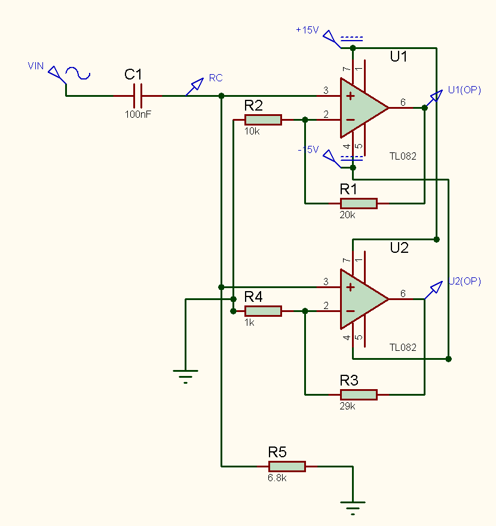
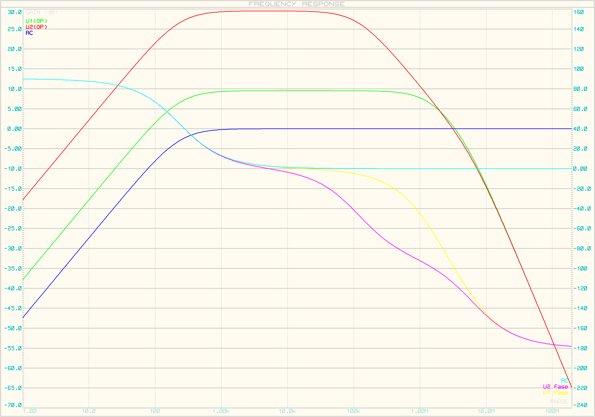
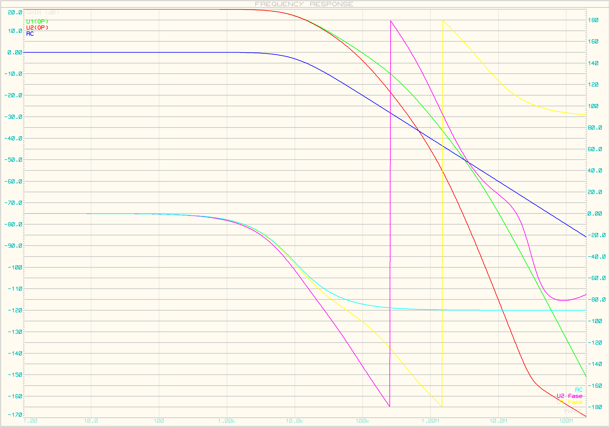
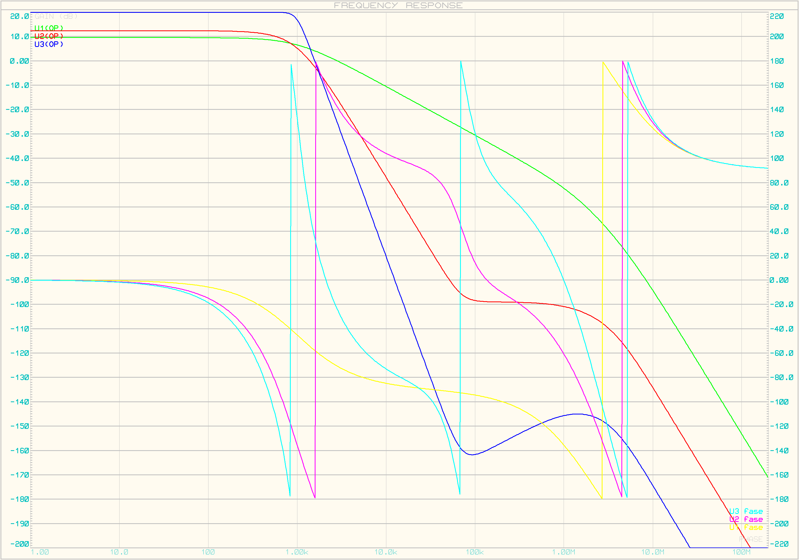

# Análise 01 - Filtros ativos com amplificadores operacionais

**Curso:** Engenharia Eletrônica **Unidade curricular:** Filtros Ativos **Professor:** Luis Carlos Martinhago Schlichting

## 1. Objetivo

Projetar, simular e analisar quatro filtros ativos e montar o último em bancada:

| Item | Filtro | Corte | Ganho | Amplificador |
|:---:|---|---:|---:|---|
| 1 | Passa-alta de primeira ordem | 230 Hz | 3 | TL082 |
| 2 | Passa-alta de primeira ordem | 230 Hz | 30 | TL082 |
| 3 | Passa-baixa de primeira ordem | 10 kHz | 10 | TL082 e LM324 |
| 4 | Passa-baixa de quinta ordem | 1 kHz | 10 | TL082 |

No item 4, a aproximação, o corte, o ganho e o amplificador são escolha minha. Para cada filtro levanto módulo e fase de 1 Hz a 200 MHz e leio o ganho na banda passante, o ganho e a fase no corte e a taxa de atenuação.

## 2. Projeto

### 2.1 Filtros de primeira ordem

Os três usam uma rede RC seguida de um amplificador não inversor. A rede define o corte e o amplificador define o ganho. Isso dá os dois pontos de medida pedidos: o nó RC (antes da parte ativa) e a saída do amplificador (depois).

$$f_c=\frac{1}{2\pi RC}\qquad K=1+\frac{R_f}{R_g}$$

$$H_{PA}(s)=K\,\frac{sRC}{1+sRC}\qquad H_{PB}(s)=K\,\frac{1}{1+sRC}$$

No passa-alta o capacitor fica em série e o resistor vai ao terra; no passa-baixa é o contrário.

### 2.2 Itens 1 e 2: passa-alta, 230 Hz

Com C = 100 nF:

$$R=\frac{1}{2\pi\cdot 230\cdot 100\ \text{nF}}=6{,}92\ \text{k}\Omega\ \rightarrow\ 6{,}8\ \text{k}\Omega$$

Com o valor comercial o corte fica em 234 Hz, 1,8 % acima do pedido. Para o ganho, $R_f/R_g=K-1$:

| Item | Ganho | $R_f/R_g$ | $R_f$ | $R_g$ |
|:---:|---:|---:|---|---:|
| 1 | 3 | 2 | 20 kΩ | 10 kΩ |
| 2 | 30 | 29 | 29 kΩ (27 kΩ + 2 kΩ) | 1 kΩ |

O enunciado pede ganho 30 no item 2 e cita "ganhos 3 e 29" na comparação. Adotei 30; 29 é a razão $R_f/R_g$ que dá esse ganho.

### 2.3 Item 3: passa-baixa, 10 kHz, ganho 10

Com C = 10 nF, R = 1,59 kΩ → 1,6 kΩ, e o corte fica em 9,95 kHz. O ganho 10 pede $R_f/R_g=9$: $R_g$ = 1 kΩ e $R_f$ = 9 kΩ (dois de 18 kΩ em paralelo). O mesmo circuito é simulado com TL082 e com LM324.

### 2.4 Item 4: passa-baixa de quinta ordem

Escolhi Butterworth, corte em 1 kHz, ganho total 10 (20 dB) e TL082. Butterworth porque a banda passante é plana e os estágios pedem Q baixo: o maior Q é 1,62, contra 5,6 de um Chebyshev de 1 dB da mesma ordem, difícil de acertar com resistores de 5 %. O corte em 1 kHz fica longe dos limites de banda e de slew rate do TL082.

O polinômio de Butterworth de quinta ordem, normalizado, tem um termo de primeira ordem e dois de segunda:

$$D(s)=(s+1)(s^2+1{,}618\,s+1)(s^2+0{,}618\,s+1)$$

O filtro é a cascata de três estágios: um de primeira ordem, igual ao do item 3, e dois Sallen-Key com resistores iguais (R) e capacitores iguais (C). Nessa versão do Sallen-Key o ganho do estágio define o amortecimento:

$$H(s)=\frac{K}{(sRC)^2+(3-K)\,sRC+1}\qquad \frac{1}{Q}=3-K$$

Todos os estágios usam o mesmo RC. Com C = 10 nF, R = 15,9 kΩ → 16 kΩ, e o corte fica em 995 Hz.

| Estágio | Termo | K calculado | $R_b$ e $R_a$ | K obtido | $1/Q$ obtido |
|:---:|---|---:|---|---:|---:|
| 1 | $s+1$ | livre | 20 kΩ e 10 kΩ | 3,00 | não se aplica |
| 2 | $s^2+1{,}618s+1$ | 3 - 1,618 = 1,382 | 3,9 kΩ e 10 kΩ | 1,39 | 1,61 |
| 3 | $s^2+0{,}618s+1$ | 3 - 0,618 = 2,382 | 13,8 kΩ (12 kΩ + 1,8 kΩ) e 10 kΩ | 2,38 | 0,62 |

Em cada estágio, $K=1+R_b/R_a$. Os ganhos dos estágios 2 e 3 são impostos pelo Q e, multiplicados, dão 3,31. O estágio 1 completa o total: 3 × 1,39 × 2,38 = 9,92 V/V (19,9 dB). O estágio de maior Q fica por último, para o pico dele não saturar os anteriores.

São três amplificadores, ou seja, dois TL082. O amplificador que sobra fica como seguidor com a entrada no terra.

## 3. Previsão teórica

Calculei as respostas com as funções de transferência da seção 2 e um amplificador de um polo, com produto ganho-banda (GBW) de 3 MHz no TL082 e 1 MHz no LM324. Em um estágio não inversor de ganho K, esse polo aparece em $GBW/K$.

| Filtro | Ganho na banda passante | Corte | Ganho no corte | Fase no corte | Taxa de atenuação | Polo do amplificador |
|---|---:|---:|---:|---:|---:|---:|
| Item 1, passa-alta, ganho 3 | 9,54 dB | 234 Hz | 6,53 dB | +45° | 20 dB/déc | 1 MHz |
| Item 2, passa-alta, ganho 30 | 29,5 dB | 233 Hz | 26,5 dB | +45° | 20 dB/déc | 100 kHz |
| Item 3, passa-baixa, TL082 | 20,0 dB | 9,94 kHz | 17,0 dB | -46,9° | -20 dB/déc | 300 kHz |
| Item 3, passa-baixa, LM324 | 20,0 dB | 9,85 kHz | 17,0 dB | -50,3° | -20 dB/déc | 100 kHz |
| Item 4, quinta ordem | 19,9 dB | 995 Hz | 16,9 dB | -225° | -100 dB/déc | 1 MHz (estágio 1) |

O que espero ver na simulação:

- **Parte ativa:** soma o ganho à curva do RC, sem mudar o corte nem a inclinação.
- **Ganho:** quanto maior, mais baixo fica o polo do amplificador. O passa-alta vira um passa-faixa, com limite superior em 1 MHz (ganho 3) ou 100 kHz (ganho 30).
- **Amplificador:** no item 3 o polo do LM324 fica só uma década acima do corte e já atrasa a fase em 5° em 10 kHz. No TL082 o efeito é três vezes mais distante.
- **Quinta ordem:** cinco polos dão 100 dB/déc e -225° no corte, 45° por polo.

As curvas teóricas aparecem tracejadas nos Gráficos 1, 2 e 3, junto com as simuladas.

## 4. Simulação no Proteus

Em todos os circuitos a entrada é um gerador senoidal de 1 V, a alimentação é de ±15 V e o gráfico FREQUENCY varre de 1 Hz a 200 MHz com 100 pontos por década. Há uma ponta de tensão no nó RC e uma em cada saída. Os amplificadores usam os modelos SPICE do Proteus (`TL082` e `LM324/NS`).

Fiz as leituras nos dados exportados do gráfico (Export Graph Data):

- **Ganho na banda passante:** valor do patamar.
- **Frequência de corte:** onde o ganho fica 3 dB abaixo do patamar.
- **Ganho e fase no corte:** valores das duas curvas nessa frequência.
- **Taxa de atenuação:** diferença de ganho entre duas frequências, dividida pelo número de décadas entre elas.

Exemplo, com o item 1: o patamar é 9,54 dB, e a curva cruza 6,54 dB em 234 Hz, onde a fase é +45,0°. Na região de queda o ganho é -30,44 dB em 2,34 Hz e -10,49 dB em 23,4 Hz: 19,95 dB em uma década.

### 4.1 Passa-alta (itens 1 e 2)

*Figura 1 - Passa-alta no Proteus: U1 com ganho 3 e U2 com ganho 30, ligados ao mesmo nó RC.*

*Figura 2 - Gráfico do Proteus, de 1 Hz a 200 MHz. Ganho em dB no eixo esquerdo: ganho 3 em verde, ganho 30 em vermelho e nó RC em azul. Fase em graus no eixo direito: ganho 3 em amarelo, ganho 30 em magenta e nó RC em ciano.*

*Gráfico 1 - Passa-alta: os dados do Proteus (linha contínua) sobre a curva teórica (tracejado).*

| Curva | Ganho na banda passante | Corte inferior | Ganho no corte | Fase no corte | Taxa de atenuação | Corte superior |
|---|---:|---:|---:|---:|---:|---:|
| Nó RC (antes) | 0,00 dB | 234 Hz | -3,01 dB | +45,0° | 20,0 dB/déc | não há |
| Item 1, ganho 3 | 9,54 dB | 234 Hz | 6,53 dB | +45,0° | 20,0 dB/déc | 1,38 MHz |
| Item 2, ganho 30 | 29,52 dB | 233 Hz | 26,51 dB | +45,0° | 20,0 dB/déc | 117 kHz |

**Antes e depois da parte ativa.** Abaixo de 10 kHz as três curvas têm a mesma forma: a saída é a curva do RC mais 9,54 dB ou 29,52 dB, com a mesma fase. O corte e a inclinação de 20 dB/déc não mudam.

**Influência do ganho.** O ganho só altera a alta frequência. Em 100 kHz a saída de ganho 3 ainda está em 9,52 dB e -5°, e a de ganho 30 já caiu para 27,1 dB e -41°. O corte superior ficou em 1,38 MHz e 117 kHz: multiplicar o ganho por 10 custou cerca de uma década de banda.

**Influência do amplificador.** O limite superior é do TL082, não da rede RC, que continua em 0 dB até 200 MHz. O modelo do Proteus tem GBW perto de 4 MHz, acima dos 3 MHz da previsão, e por isso os cortes superiores simulados são maiores que os teóricos. Acima de 3 MHz a fase passa de -90° e chega a -178°: o modelo tem um segundo polo, que a previsão não considera.

### 4.2 Passa-baixa (item 3)

*Figura 3 - Passa-baixa no Proteus: U1 com modelo TL082 e U2 com modelo LM324, com os mesmos resistores.*

*Figura 4 - Gráfico do Proteus, de 1 Hz a 200 MHz. Ganho no eixo esquerdo: TL082 em verde, LM324 em vermelho e nó RC em azul. Fase no eixo direito: TL082 em amarelo, LM324 em magenta e nó RC em ciano. O Proteus mostra a fase entre -180° e +180°, daí os saltos em 260 kHz e 1,5 MHz. Abaixo de -100 dB os valores não têm significado prático.*

*Gráfico 2 - Passa-baixa: os dados do Proteus (linha contínua) sobre a curva teórica (tracejado), com a fase sem os saltos.*

| Curva | Ganho na banda passante | Corte | Ganho no corte | Fase no corte | Taxa de 100 kHz a 1 MHz |
|---|---:|---:|---:|---:|---:|
| Nó RC (antes) | 0,00 dB | 9,94 kHz | -3,01 dB | -45,0° | -20,0 dB/déc |
| TL082 | 20,00 dB | 9,93 kHz | 16,99 dB | -46,6° | -29,1 dB/déc |
| LM324 | 20,00 dB | 9,81 kHz | 16,99 dB | -52,0° | -41,3 dB/déc |

**Antes e depois da parte ativa.** Até o corte, a saída é a curva do RC mais 20 dB. Depois dele, o RC segue em -20 dB/déc e para em -90°, enquanto as saídas caem mais rápido e continuam atrasando, porque o polo do amplificador se soma ao do filtro.

**TL082 e LM324.** Na banda passante e no corte os dois dão o mesmo módulo. A diferença está na fase e acima do corte:

| Frequência | TL082 | LM324 |
|---:|---:|---:|
| 10 kHz | 16,96 dB, -46,9° | 16,90 dB, -52,7° |
| 100 kHz | -0,4 dB, -101° | -3,9 dB, -142° |
| 1 MHz | -29,6 dB, -169° | -45,3 dB, -244° |

Com ganho 10, o polo do LM324 fica perto de 100 kHz e o do TL082 perto de 400 kHz. No corte o LM324 já atrasa 5° a mais que o TL082; em 1 MHz a diferença é de 16 dB e 75°. Para um passa-baixa de 10 kHz com ganho 10, o TL082 fica mais perto da resposta de primeira ordem. O LM324 atende se só o módulo até o corte importar.

### 4.3 Quinta ordem (item 4)

*Figura 5 - Quinta ordem no Proteus: estágio de primeira ordem (U1) e dois Sallen-Key (U2 e U3).*

*Figura 6 - Gráfico do Proteus, de 1 Hz a 200 MHz. Ganho no eixo esquerdo: saída do estágio 1 em verde, do estágio 2 em vermelho e do filtro em azul. Fase no eixo direito: estágio 1 em amarelo, estágio 2 em magenta e filtro em ciano, com saltos onde ela cruza -180°. A reta em -200 dB acima de 25 MHz é o piso numérico do Proteus, não uma medida.*

*Gráfico 3 - Quinta ordem: os dados do Proteus (linha contínua) sobre a curva teórica (tracejado), com a fase sem os saltos.*

| Ponto | Ganho na banda passante | Corte (-3 dB) | Ganho no corte | Fase no corte | Taxa de atenuação |
|---|---:|---:|---:|---:|---:|
| Saída do estágio 1 | 9,54 dB | 995 Hz | 6,53 dB | -45,0° | -20,0 dB/déc (10 a 100 kHz) |
| Saída do estágio 2 | 12,40 dB | 639 Hz | 9,39 dB | -93,2° | -57,5 dB/déc (2 a 10 kHz) |
| Saída do filtro | 19,93 dB | 995 Hz | 16,92 dB | -225,4° | -100,0 dB/déc (2 a 4 kHz) |

A simulação repete a previsão: 19,93 dB, corte em 995 Hz, -225° no corte e 100 dB/déc. A banda passante é plana, com máximo de 19,95 dB, e de 2 kHz a 10 kHz a saída cai de -10,3 dB para -80,3 dB.

Os estágios isolados não são Butterworth: o estágio 2 já está 3 dB abaixo em 639 Hz, e o pico do estágio 3 perto do corte compensa essa queda. Só o conjunto é plano até 1 kHz.

**Influência do amplificador.** Em 1 kHz o TL082 não aparece na resposta. Ele aparece na banda de rejeição: acima de 100 kHz a saída do estágio 2 para de cair e fica em -99 dB, e a saída do filtro sobe de -162 dB para -146 dB em 1 MHz. No Sallen-Key o capacitor de realimentação liga a entrada à saída do amplificador; quando o ganho de malha acaba, o sinal passa por esse caminho. Na bancada isso não aparece: -99 dB de 1 Vpp são 11 µV.

## 5. Implementação prática do filtro de quinta ordem

> **Pendente.** Montagem e medidas ainda não feitas.

Previsão para a bancada, com 1 Vpp na entrada e alimentação de ±15 V:

| Frequência | Ganho previsto | Saída prevista | Fase prevista | Entrada medida | Saída medida | Ganho medido | Fase medida |
|---:|---:|---:|---:|---:|---:|---:|---:|
| 100 Hz | 9,93 (19,9 dB) | 9,93 Vpp | -19° | | | | |
| 200 Hz | 9,93 (19,9 dB) | 9,93 Vpp | -37° | | | | |
| 500 Hz | 9,95 (20,0 dB) | 9,95 Vpp | -97° | | | | |
| 800 Hz | 9,44 (19,5 dB) | 9,44 Vpp | -168° | | | | |
| 1 kHz | 6,94 (16,8 dB) | 6,94 Vpp | -227° | | | | |
| 1,2 kHz | 3,62 (11,2 dB) | 3,62 Vpp | -275° | | | | |
| 1,5 kHz | 1,26 (2,0 dB) | 1,26 Vpp | -318° | | | | |
| 2 kHz | 0,30 (-10,4 dB) | 302 mVpp | -355° | | | | |
| 3 kHz | 0,040 (-28,0 dB) | 40 mVpp | -388° | | | | |

O osciloscópio mostra a fase entre -180° e +180°: -227° aparece na tela como +133°, e -355°, como +5°.

A varredura AC do Proteus é linear e não mostra saturação nem slew rate. Conferi os dois à parte: a saída máxima, de 9,95 Vpp, cabe na alimentação de ±15 V, e com o slew rate de 13 V/µs do TL082 uma senoide dessa amplitude só deforma acima de $f=SR/(\pi V_{pp})\approx 416$ kHz.

## 6. Conclusão

> **Parcial.** Falta a comparação com a bancada do filtro de quinta ordem.

Os quatro filtros simulados atendem ao projeto. Os passa-alta cortam em 234 Hz com 9,54 dB e 29,52 dB; o passa-baixa corta em 9,93 kHz com 20,00 dB; o de quinta ordem corta em 995 Hz com 19,93 dB, -225° no corte e 100 dB/déc. A diferença para os 230 Hz, 10 kHz e 1 kHz pedidos vem do arredondamento dos resistores para valores comerciais.

Nos filtros de primeira ordem a parte ativa não muda o corte nem a inclinação da rede RC: ela soma o ganho e acrescenta o polo do amplificador. Esse polo desce na proporção em que o ganho sobe, de 1,38 MHz com ganho 3 para 117 kHz com ganho 30.

O amplificador pesa quando esse polo fica perto do corte. No passa-baixa de 10 kHz com ganho 10, o LM324 atrasa a fase 5° a mais que o TL082 no corte e 75° a mais em 1 MHz, com o mesmo módulo na banda passante. No filtro de quinta ordem, com corte em 1 kHz, o TL082 só aparece na banda de rejeição, em níveis que a bancada não mede.

A previsão com amplificador de um polo acertou ganho, corte e fase no corte com erro menor que 0,1 dB e 2°. Ela erra acima de 1 MHz, onde os modelos do Proteus têm mais polos.
