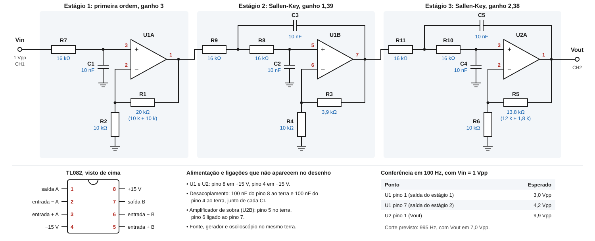

# Roteiro de bancada: passa-baixa Butterworth de quinta ordem

Corte previsto de 995 Hz, ganho de 9,92 V/V (19,9 dB), queda de 100 dB/década.

## Material

| Qtde | Componente | Uso |
|---:|---|---|
| 2 | TL082 | três amplificadores usados, um de sobra |
| 5 | resistor 16 kΩ (ou 15 kΩ + 1 kΩ em série) | resistores de filtro |
| 5 | capacitor 10 nF, poliéster | capacitores de filtro |
| 5 | resistor 10 kΩ | três $R_a$ e dois em série para os 20 kΩ |
| 1 | resistor 3,9 kΩ | $R_b$ do estágio 2 |
| 1 | resistor 12 kΩ e 1 resistor 1,8 kΩ | $R_b$ do estágio 3, em série |
| 4 | capacitor 100 nF, cerâmico | desacoplamento da alimentação |

Se puder, meça os cinco capacitores de 10 nF e os cinco resistores de 16 kΩ antes de montar e anote os valores. O corte medido segue o RC real, e um capacitor de 10 % fora do valor desloca o corte na mesma proporção.

## Pinagem do TL082

| Pino | Função | Pino | Função |
|---:|---|---:|---|
| 1 | saída A | 8 | +15 V |
| 2 | entrada - A | 7 | saída B |
| 3 | entrada + A | 6 | entrada - B |
| 4 | -15 V | 5 | entrada + B |

Em cada CI, um capacitor de 100 nF do pino 8 ao terra e outro do pino 4 ao terra, o mais perto possível do chip.

## Esquemático

Os números em vermelho são os pinos do TL082. Os nomes dos componentes (R7, C1, ...) são os mesmos do projeto `proteus/item_4_quinta_ordem.pdsprj`. Há uma cópia em PNG, para abrir no celular ou imprimir: `imgs/protoboard/esquematico_bancada.png`.

## Ligações

**Estágio 1 (U1, amplificador A): primeira ordem, ganho 3**

| Componente | De | Para |
|---|---|---|
| 16 kΩ | entrada do filtro | U1 pino 3 |
| 10 nF | U1 pino 3 | terra |
| 20 kΩ (10 kΩ + 10 kΩ) | U1 pino 1 | U1 pino 2 |
| 10 kΩ | U1 pino 2 | terra |

**Estágio 2 (U1, amplificador B): Sallen-Key, ganho 1,39**

| Componente | De | Para |
|---|---|---|
| 16 kΩ | U1 pino 1 | nó A2 |
| 16 kΩ | nó A2 | U1 pino 5 |
| 10 nF | nó A2 | U1 pino 7 |
| 10 nF | U1 pino 5 | terra |
| 3,9 kΩ | U1 pino 7 | U1 pino 6 |
| 10 kΩ | U1 pino 6 | terra |

**Estágio 3 (U2, amplificador A): Sallen-Key, ganho 2,38**

| Componente | De | Para |
|---|---|---|
| 16 kΩ | U1 pino 7 | nó A3 |
| 16 kΩ | nó A3 | U2 pino 3 |
| 10 nF | nó A3 | U2 pino 1 |
| 10 nF | U2 pino 3 | terra |
| 13,8 kΩ (12 kΩ + 1,8 kΩ) | U2 pino 1 | U2 pino 2 |
| 10 kΩ | U2 pino 2 | terra |

**Amplificador de sobra (U2, B):** pino 5 no terra e pino 6 ligado ao pino 7.

A saída do filtro é o pino 1 de U2.

## Medidas

- **Alimentação:** ±15 V.
- **Entrada:** senoide de 1 Vpp, sem offset. A saída chega a 9,95 Vpp na banda passante.
- **Osciloscópio:** CH1 na entrada, CH2 na saída, as duas pontas na mesma atenuação (x10) e o canal configurado igual. Na Atividade 02 a primeira rodada foi descartada por causa disso.
- **Leituras em cada frequência:** Vpp dos dois canais, fase e uma foto da tela.
- **Frequências:** 100, 200, 500 e 800 Hz; 1, 1,2, 1,5, 2 e 3 kHz.
- **Corte:** depois da tabela, varie a frequência perto de 1 kHz até a saída cair para 0,707 do valor medido em 100 Hz (cerca de 7,0 Vpp) e anote essa frequência e a fase.

A fase aparece na tela entre -180° e +180°: perto do corte o osciloscópio deve indicar algo em torno de +135°, que corresponde a -225°.

Em 3 kHz a saída prevista é de 40 mVpp. Se o ruído atrapalhar, aumente a entrada para 5 Vpp só nesse ponto: a saída continua pequena e o ganho é o mesmo.

## Conferência rápida antes de medir

Meça a saída de cada estágio em 100 Hz com 1 Vpp na entrada. Os valores esperados localizam um erro de montagem sem precisar desmontar nada:

| Ponto | Esperado em 100 Hz |
|---|---:|
| U1 pino 1 (estágio 1) | 3,0 Vpp |
| U1 pino 7 (estágio 2) | 4,2 Vpp |
| U2 pino 1 (saída) | 9,9 Vpp |

## Fotos

Salvar em `imgs/protoboard/` com os nomes de `imgs/protoboard/LEIA-ME.txt`.
